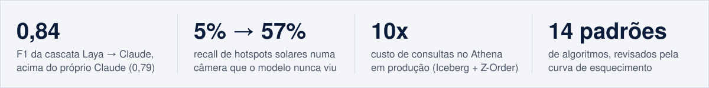
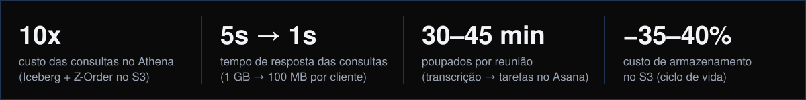

 

 

 

### [thermal-pv-hotspots-assimilation](https://github.com/renatospessotto/thermal-pv-hotspots-assimilation)

**Hotspots em usinas solares por drone térmico, com qualquer câmera.** Um detector treinado numa usina perde muito desempenho na seguinte: outra câmera, altitude, ângulo e paleta. A ideia foi tratar isso como a previsão do tempo trata satélites diferentes: **separar o fenômeno do jeito de observá-lo**.

- **Lê a temperatura, não a cor.** Leitores radiométricos (FLIR, DJI R-JPEG) em Python puro; o ΔT_z mede quanto cada ponto está acima dos painéis vizinhos e é pintado numa paleta fixa, reamostrado para 3 cm/px.
- **DINOv3 congelado + regressão logística**, célula a célula, somada a termos de **assimilação de dados**: correção de viés pelos metadados do voo (como o VarBC), ganho de Kalman pela qualidade da aquisição, viés de cada anotador e controle de qualidade dos rótulos.
- **Numa câmera nunca vista:** recall **5% → 57%**, AUROC **0,836 → 0,927**, recuperando **62%** da perda de desempenho. Uso indicado: triagem.
- **Entrega:** pacote Python (`analisar("foto.jpg")`) com alerta de fora-de-distribuição e pesos de ~7 MB no Hugging Face.

<b>Ver o gráfico: cada etapa de assimilação numa câmera nova</b>

 

### [review-intelligence-ptbr](https://github.com/renatospessotto/review-intelligence-ptbr)

**Laya × BERTimbau × Qwen3.5-2B (QLoRA), destilados do Claude, lendo reviews de e-commerce em português.** O Claude Haiku rotulou 10 mil reviews da Olist em cinco aspectos (entrega, produto, atendimento, preço, embalagem); os modelos pequenos aprenderam com esses rótulos e foram avaliados num conjunto ouro independente (kappa 0,86).

- **Qualidade a uma fração do custo:** os modelos pequenos chegam a 94% do F1 do Claude (**0,74**), custando de **30 a 300 vezes menos**.
- **Calibração:** o Laya (ECE 0,014) e o BERTimbau (ECE 0,006) dizem o quanto confiam em cada resposta.
- **Cascata:** o modelo pequeno responde primeiro e só manda ao Claude os casos em que está inseguro. Com **20%** das chamadas, a cascata chega a **F1 0,84**, acima do próprio Claude (0,79).
- **Entrega:** modelos e dataset no Hugging Face, API FastAPI e demo Gradio com `docker compose up`.

<b>Ver o gráfico: qualidade × custo de cada modelo</b>

 

### [algorithm-patterns-trainer](https://github.com/renatospessotto/algorithm-patterns-trainer)

**Um app full-stack de repetição espaçada para padrões de algoritmos de entrevista.** Em vez de resolver problemas aleatórios, ele ensina **14 macro-padrões** (HashMap, Two Pointers, Sliding Window, …, Trie/Bits) por uma sequência curada de **46 problemas-núcleo** e mantém tudo fresco com 2 exercícios por dia: sempre os que você tem mais chance de ter esquecido.

- **Sem data de revisão, sem acúmulo.** Cada problema tem uma urgência pela curva de esquecimento, `1 − e^(−Δt/estabilidade)`, calculada na hora. A estabilidade se adapta a uma média móvel exponencial dos resultados e ao tempo gasto em relação a uma meta por dificuldade.
- **Currículo em fases.** Introdução pela sequência fixa → consolidação (só revisão, completada pelo seu padrão *mais fraco*) → fase livre, com cerca de **2.900 problemas** filtráveis por padrão.
- **Dados reproduzíveis, nenhum dado no git.** Um ETL em Python cruza dois datasets públicos fixados por commit e mapeia as tags oficiais para os 14 padrões, dentro do build do Docker.
- **Um container em produção.** O Angular vai dentro do jar do Spring Boot; o Flyway cuida do schema e do seed. Telas de hoje, explorar, estatísticas (heatmap, sequências, padrões fracos/fortes), histórico e leitura de papers.

 

Sistemas de IA generativa e dados que entreguei para clientes entre mai/2025 e abr/2026. O código é privado; aqui ficam o problema e o resultado.

| Projeto | O que faz | Resultado | Stack |
|---|---|---|---|
| **Consultas 10x mais baratas** | Para um cliente de consultoria farmacêutica, migrei o dataset de clustering para **Apache Iceberg** com **Z-Order** no S3 | Dados lidos por cliente de **1 GB para 100 MB**, custo das consultas no Athena **10x menor**, resposta de **5s para 1s** | Iceberg, S3, Athena |
| **Chatbot com RAG** | Atendimento de um SaaS de contabilidade: busca os dados da empresa num banco vetorial e responde com um LLM | Assumiu as dúvidas simples de clientes antes respondidas por um funcionário | n8n, Qdrant, Redis, RabbitMQ |
| **Reuniões → tarefas** | Lê transcrições do Google Meet, extrai os itens de ação com um LLM e cria as tarefas no Asana, no projeto e com o responsável certos | Poupa **30–45 min de organização por reunião** (estimativa de 120–360 h/ano por gerente de projeto) | n8n, LLM, Asana |
| **Mensagens de recompra** | Gera mensagens personalizadas a partir do perfil de cada cliente | Em produção na AWS com alta disponibilidade (CloudFront, ECS, Auto Scaling, Secrets Manager) e CI/CD por OIDC | FastAPI, LangChain, React, AWS |
| **Armazenamento no S3** | Políticas de ciclo de vida nos buckets do S3 | **35–40% menos** custo de armazenamento | S3 |

**Outros projetos:** [bertimbau-mental-health-ptbr](https://github.com/renatospessotto/bertimbau-mental-health-ptbr) · [vit-vs-cnn-oxford-pets](https://github.com/renatospessotto/vit-vs-cnn-oxford-pets) · [copd-cough-audio-classifier](https://github.com/renatospessotto/copd-cough-audio-classifier) · [firewall-log-genetic-programming](https://github.com/renatospessotto/firewall-log-genetic-programming) · [rice-yield-automl-autogluon](https://github.com/renatospessotto/rice-yield-automl-autogluon)

 

**IA e ML**

**Backend e cloud**

**Dados**

*In English:* Computer Science student at ICMC/USP (Brazil), tech intern at Embraer, previously building generative AI and data systems in production at Cognitivo.ai (e.g., Athena queries 10x cheaper with Iceberg + Z-Order, a RAG chatbot that took over routine customer questions). Highlights: [algorithm-patterns-trainer](https://github.com/renatospessotto/algorithm-patterns-trainer), a full-stack spaced-repetition trainer (Spring Boot, Angular, PostgreSQL); [thermal-pv-hotspots-assimilation](https://github.com/renatospessotto/thermal-pv-hotspots-assimilation), camera-invariant solar hotspot detection using data-assimilation ideas from weather forecasting; and [review-intelligence-ptbr](https://github.com/renatospessotto/review-intelligence-ptbr), which distills Claude into small calibrated encoders whose cascade beats the teacher with 20% of the API calls.
